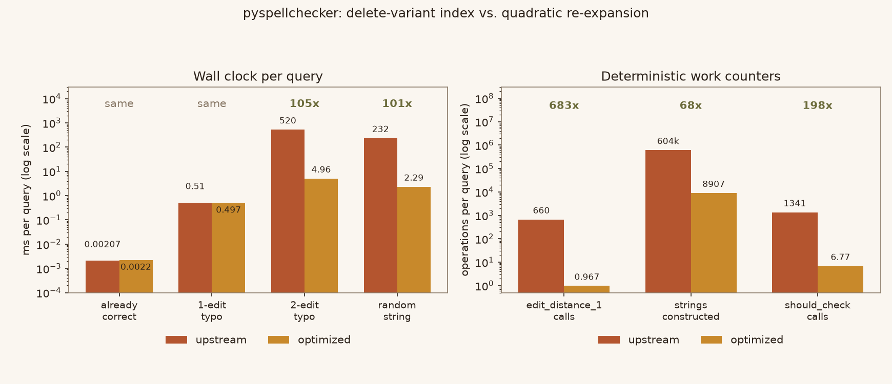
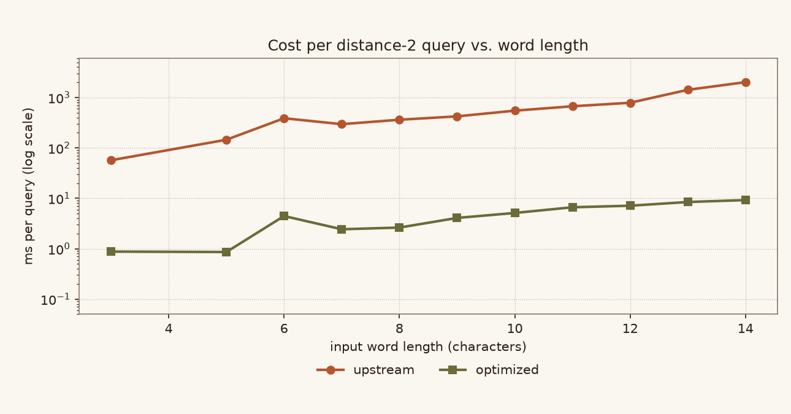

# pyspellchecker — delete-variant index for distance-2 lookup

An optimisation of [**barrust/pyspellchecker**](https://github.com/barrust/pyspellchecker), a
pure-Python spell checker (MIT, baseline commit `14ec8657` / v0.9.1).

**Read the full report as a page:** <https://linluozi.github.io/pyspellchecker-delete-index-opt/>

> Correcting one misspelled word used to cost **0.33 – 0.89 s**. It now costs **~5 ms**, while
> returning *exactly* the same candidate set — verified element by element on 2,100 real queries
> and 71,829 exhaustive ones.

| measurement | upstream | optimised | change |
| --- | ---: | ---: | --- |
| 2-edit typo, ms per query | 519.9 | 4.96 | **105× faster** |
| random string, ms per query | 232.3 | 2.29 | **101× faster** |
| interleaved A/B, 7 rounds, median | 15,573 ms | 146.5 ms | **106.5× faster** |
| noise floor (same code vs itself) | — | — | 1.003× |
| strings constructed per 2-edit query | 603,756 | 8,907 | **68× fewer** |
| index build, one-off | — | 0.79 s | +0.79 s |
| resident memory | 43.4 MB | 145.9 MB | **+102.6 MB** |





## The defect

`SpellChecker.candidates()` falls back to a second full expansion of the edit-distance-one
neighbourhood when no one-edit correction exists:

```python
return [e2 for e1 in tmp for e2 in self.known(self.edit_distance_1(e1))]
```

For the bundled English dictionary `|E1|` is 675 strings for a 7-letter word and 1,125 for a
12-letter word, so this builds and dictionary-tests `|E1|²` — roughly **600,000 strings per input
word**. Measured cost of that single fallback: 578 ms (`accomodate`), 886 ms (`maintainance`).

The distance is unrestricted **Damerau-Levenshtein**, not Levenshtein and not OSA: the layered
expansion allows a deletion followed by a transposition of characters that were not neighbours
originally (`alot → aot → oat`). A replacement that verifies with an OSA DP silently loses
candidates.

## The change

One file, `spellchecker/spellchecker.py`, ~120 added lines:

- **`WordFrequency._get_delete_index()`** — a reverse index from every dictionary word *and* every
  one-character deletion of it, back to the word(s) it came from. Built lazily on the first
  distance-2 query; dropped whenever the dictionary changes.
- **`SpellChecker.__edit_distance_alt()`** — instead of expanding each `e1` again, look `e1` and its
  one-deletions up in the index, then verify each hit with the linear
  `__is_within_one_edit()` predicate.

The index is exact rather than approximate: if two strings are at Damerau-Levenshtein distance ≤ 1,
their sets of "at most one deletion" variants intersect. Design notes — why one deletion instead of
two, and why a bucket is a bare string until a second word maps to it — are in
[`optimized/OPTIMIZATION.md`](optimized/OPTIMIZATION.md).

## Verification

| check | result |
| --- | --- |
| upstream test suite (`pytest tests`) | 59 passed, before and after |
| `ruff check` + `ruff format --check` (upstream CI) | clean |
| 2,100 real-dictionary queries (correct / 1-edit / 2-edit / random) | **2,100 / 2,100 identical** |
| exhaustive sweeps, 5 configurations, small dictionary | **71,829 queries, 0 differences** |
| poison test (verification deliberately disabled) | harness reports hundreds of mismatches → it has teeth |
| `changes.patch` applies and reproduces `optimized/` | byte-for-byte (`patch -p1`, then `cmp`) |
| `LICENSE` versus upstream | byte-identical (`sha1 39f9d947…`) |

`bench/verify.json` holds the raw record of every run quoted above.

## Layout

```
optimized/         the patched package (pip-installable; LICENSE untouched)
upstream/          the untouched baseline, for side-by-side comparison
changes.patch      unified diff of the single changed file
index.html         the report as a single self-contained page
bench/             every script that produced the numbers, plus the raw results
  gen_words.py     deterministic query set (seed 20261018)  -> words.json
  run_queries.py   run a query set against one implementation
  compare.py       element-by-element comparison + timing table
  exhaustive.py    exhaustive sweep on a small dictionary (--poison tests the harness)
  drive.py         interleaved A/B across fresh processes, plus a noise floor
  scan_len.py      cost against input word length
  count_ops.py     deterministic work counters (no stopwatch)
  mem_index.py     index build time and RSS, per encoding, own process
  make_figures.py  both figures          make_page.py  this report as HTML
```

## Reproduce

```bash
pip install pytest psutil ruff

(cd upstream  && pytest tests -q)     # 59 passed — untouched baseline
(cd optimized && pytest tests -q)     # 59 passed — patched tree

python bench/compare.py               # 2,100 / 2,100 identical  (~8 min: upstream is the slow side)
python bench/exhaustive.py --alpha abcd --maxlen 7
python bench/drive.py dist2 7 40      # interleaved A/B + noise floor
python bench/count_ops.py optimized bench/words.json dist2 150
```

Re-apply the patch yourself:

```bash
cp -r upstream /tmp/base && cd /tmp/base
patch -p1 < ../changes.patch
```

The repository stores text as LF (`.gitattributes`), so the patch applies to a fresh checkout
without any flags. If your working copy has CRLF endings — for instance a bare
`git clone` with `core.autocrlf=true` and no `.gitattributes` — add `--binary`, otherwise `patch`
silently strips the carriage returns and the result is one byte per line short even though it
reports success.

## License

MIT, unchanged. `optimized/LICENSE` is byte-identical to `upstream/LICENSE`. The modifications are
listed in [`optimized/NOTICE.md`](optimized/NOTICE.md) and released under the same MIT terms.
Upstream copyright © 2018-2021 Tyler Barrus.
